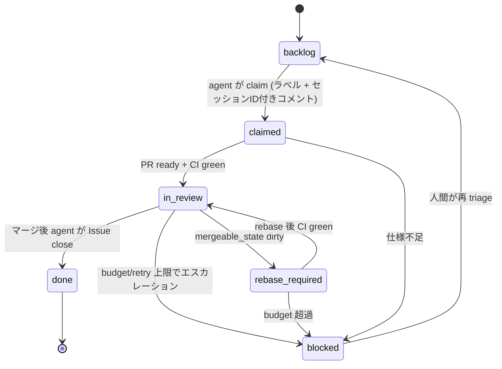
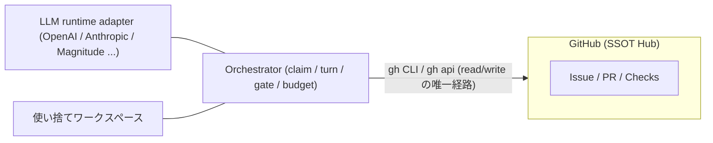

# fourth_power 起案書 — forge (GitHub / GitLab) を SSOT とする LLM 自律開発フレームワーク

状態: Draft / 決定が必要な論点は §9 に一覧。 normative な仕様は `docs/spec.md` を参照 (本節は背景・動機のみ。例外: 付録 A の型定義は spec §1・§6 の pointer が normative を担うため、付録 A も normative のポインタ先である)。

## 1. 背景と目的

- LLM エージェントが Issue → 実装 → PR → CI → マージ を自律的に繰り返す開発基盤を作る。
- 開発の正式な履歴・状態はすべて forge 側に置き、ローカル側には状態を保持しない。GitHub / GitLab は normalized object model (spec §11) で同一設計から provider を差し替えられ、選択はプロジェクト毎 (起動は 1 プロジェクト指定)。
- 到達点: CI とレビュー承認をゲートにした自律マージ。承認は tier で決める (低リスクは自動チェック green のみでマージ可、高リスク path は常に人間)。初期は全 PR に人間承認 1 人。
- 単一ループ: 1 Issue = 1 セッション。ルーター/プランナーの subagent は持たず、手順はプロンプト層・リファランス (spec/受入契約) として運び、オーケストレーションは orchestrator の台帳機械のみ。verifier turn (別セッション fresh context の検証) は残す (spec §8)。
- 状態の二層: 永続状態 (claim/ChangeRequest/checks/accept 契約) は forge のみ、実行中間物 (ワークスペース・turn ログ) はローカル許容だが復元には使わない設計 (spec §2.1 で MUST NOT 規定)。

非ゴール(初期スコープ外): 複数リポジトリの同時 orchestration、Web ダッシュボード、独自 CI ホスト。複数 persona の多段エスカレーション強制 (TAKT 風の多段ワークフロー、persona 別 LLM 判定) は持たない (M2、spec §10)。

## 2. 不変条件 (SSOT 不変条件)

1. forge が唯一の状態 (state of truth。プロジェクト毎に単一 provider をバインド)。進行状態・成果物・決定ログは Issue/PR/Checks/commit にのみ書き、ローカル DB やローカルブランチを正式状態にしない。作業用クローン/ブランチは使い捨てで、破棄しても失われない。
2. main branch へ直接 push しない。すべて ChangeRequest 経由。マージは provider の merge 経由のみ。マージコミット履歴が監査証跡になる。
3. セッションの直前状態は forge 側に存在する。セッション中断・マシン消失後に復元できること。
4. マージ可能性は CI が決める。ローカルで green でも CI が green でなければマージしない。

## 3. normalized object model の GitHub マッピング (spec §11 の実体)

| GitHub リソース | 意味 |
|---|---|
| Issue | 作業単位 (work item) の正本。本文に受け入れ契約 (spec §4) を埋め込む |
| PR | 変更の正本。Draft → ready → マージ |
| Checks | マージ可能性の判定。required checks |
| commit / PR diff | 変更の正本。ローカル commit は参照専用 |
| release | 提供単位 (任意) |

ラベル + 時間付きコメントで状態を表現する。ローカルカウンタ・排他ロックに依存しない。



claim 競合は同一ラベルの重複コメントを CI スクリプトが検出し、先頭優先で解決する (概略図; 正しくは spec §3)。マージ後は Issue close + PR リンクが自動で残り、全遷移が監査ログになる。

blocked は原因別ラベルに分離する規定 (spec §3: `blocked/spec-gap` / `blocked/budget` / `blocked/infra`)。rebase turn も budget に算入する (spec §7)。

## 4. アーキテクチャ



- Orchestrator はローカル Poller が主役。GitHub Actions は CI・チェック・通知に限定する。Actions は長時間実行・シークレット制約が大きく、自律ループの継続/再開/予算制御を GitHub 状態だけで持つ設計と相性が悪い。
- LLM は turn 単位で呼ぶ。各 turn の入力は「GitHub から読める状態 + プロンプト層」のみ。ローカルキャッシュの正否は許容しない。
- ワークスペースのクローン破棄は許容。再クローン後 GitHub から復元する (spec §2.3 の検証対象)。
- 仕様先行: normative 変更は `docs/spec.md` の spec PR (人間レビュー済み) → マージ後にのみ許容し、そこから Issue を導出する (spec §5)。Issue 本文に spec 条項参照を必須とする。

### 4.1 ディレクトリ構成

```
fourth_power/
├── docs/PROPOSAL.md         本起案
├── docs/spec.md             normative 仕様 (RFC2119)
├── docs/governance/   config.json (既定) + projects.json (プロバイダ割当) (spec §2.6) — プロジェクト本体 repoに設定をコミしない
├── prompts/                 phase 別プロンプト (layering)
├── src/                     orchestrator (core)
│   ├── forge.mjs               forge ラッパ (read/write の唯一経路・provider 分離)
│   ├── loop.mjs             poll → claim → turn → submit
│   ├── gate.mjs             マージ判定 (required checks / 承認)
│   └── budget.mjs           turn / cost 上限、超過時 blocked
├── adapters/                LLM runtime 呼び出し (1 ファイル = 1 プロバイダ) + conformance suite
├── ci/                      acceptance テストランナー (単一 job `accept`)
├── scripts/bootstrap.mjs    label・protection・accept workflow の冪等 setup + 状態検証
├── scripts/metrics.mjs      自律マージ率の算出 (spec §9)
├── tests/fixtures/          保存済み GitHub API payload (決定表テスト用)
└── scratch/                 walking prototype 用リポジトリテンプレート
```

言語は Node/TypeScript を推奨。node --test が標準、gh は JSON を出す、jaq が JSON 加工に使える。Python は接着層に限定し、本体は作らない。

## 5. 受け入れ契約 (Acceptance Contract)

normative は spec §4。要点:

- 受け入れテストの本体は `ci/accept/<id>.test.mjs`。Issue 本文は `accept:<id>` 条項参照のみ。
- CI job は単一 `accept` のみ (per-issue workflow は不可 — required check 名が動的になり branch protection と組めない)。
- gaming 防止: 実装セッションの PR が `ci/accept/` を変更したら CI check `accept-immutable` が fail。変更は人間 / reviewer 専用 PR のみ。
- 空 green 防止: `accept:<id>` 条項に対し対応ファイルの存在照合を CI で行う規定 (spec §4.2)。条項なし Issue は claim 不可 (→ `blocked/spec-gap`)。
- bootstrap (label・protection・`accept` workflow の冪等 setup) が Issue 作成に先行する規定 (spec §4.4)。

## 6. プロンプト層と turn 契約

phase 別 (investigate / implement / verify / submit) を layering。各 turn の入力は:

1. Issue 本文 + claimed 以降のコメント (agent 著者コメントは要約のみ抽出、spec §5)
2. PR 差分と CI 結果
3. phase 固有プロンプト
4. 「状態は GitHub にしか存在しない」不変条件の再提示

submit turn は必ず PR push → gh pr ready → レビュー依頼 → Issue へ要約コメント。

## 7. 安全ゲートと予算

- branch protection: main は direct push 禁止、required checks (`accept` / `accept-immutable` / `risk-tier` / `review-threads`)、承認は tier 所定 (高リスク path は人間承認必須、低リスクは承認なしマージ可〔M3 設定〕)。protection の承認数は静的で、tier 免除は `risk-tier` check が承認記録を読んで判定する (GitHub/GitLab の protection で動的切替はできない)。承認は head SHA 変更で無効 (GitHub は commit 駆動 dismiss、GitLab は native の approval-reset 設定 + `sha-approval` の二重検証)。
- マージはゲート通過時のみ。budget 超過時は `blocked/budget` + 人間へエスカレーション。blocked は原因別ラベルに分離する (spec §3)。
- budget 状態も forge の comment に記録し、ローカルカウンタを持たない。台帳行 (consumed_usd / consumed_seconds、可視) を turn ごとに残す (spec §7)。rebase turn も台帳に算入する (spec §7)。
- プロンプトインジェクション: Issue 本文は信頼できる人間入力のみ。PR 差分由来の外部コンテンツは turn に入れない。

## 8. マイルストーンと検証 (normative は spec §10)

- M0 基盤: `docs/spec.md` の仕様 PR (人間レビュー済み) が main にマージ済みであること。bootstrap の冪等 setup と protection アサーション、`accept` ワークフローが scratch repo で稼働する規定 (spec §10)。
- M1 walking prototype: scratch repo + Issue 1 本で Issue → claim → PR → CI → マージ → Issue close の全ループを forge provider (初期 GitHub) 実測。クローン破棄 → 再クローンで同じ状態に復元できることと、CI red・承認なしでのマージ阻止、claim 重複検出の fixture 回帰を必須とする (spec §10)。
- M2 単一ループ安定化: 1 Issue = 1 セッション (複数 persona の多段エスカレーションは持たない)。gate / resume / budget の決定表テスト + `tests/fixtures/` + 原因別 blocked 統計 + adapter conformance が CI で green であることを必須とする。typical Issue の自律マージ率を `scripts/metrics.mjs` で計測。
- M3 自律率向上: low tier (cohort:typical) は承認なしでマージできる設定に移行し、cohort `cohort:typical` の自律マージ率 80% 以上 (metrics.mjs の定義に準拠、spec §9) を目標にする。高リスク path は承認必須のまま。heterogen の定義は「実装 seat が flash tier 以下かつ verifier seat が上位階層」に確定 (spec §10 の M3 修正。verifier が flash の構成は測定不能)。
- M4 お題実測: お題 1 本 (`plan:` header、author は人間) → plan turn が plan PR (`docs/plan/`) に分解案を起草 → 人間の承認 (tier high 設定) → マージ後 child Issue 起票 → 自律 claim→merge→done の連鎖を fixture のみでなく実測 (spec §10)。お題チェーンの自律率 (child Issue の介入 0 で done 到達 / チェーンの Issue 数) は metrics.mjs の optional 出力 (spec §9)。
- お題モデルの設計: plan PR は tier high 設定 — 承認ゲート = 分解への人間の判断 (spec §5・§8)。child Issue の本文は plan PR 差分からの機械的組立で自由文は禁止 (spec §5)。お題の再 triage は介入算入で child Issue の close も記録される。close = 撤回意味 (spec §3)。お題の merge/close は人間の判断なので介入で、child Issue 側の介入は (a)(b)(c) のみ (spec §9)。plan PR の close 時は child Issue を残さない (spec §5)。
- テストは provider API JSON (GitHub / GitLab の fixture) のみを input とする決定表として offline で実行でき、walking prototype は scheduled workflow で再現可能な integration test とする。provider conformance (spec §11) は選択 provider の fixture 通過を必須とする規定で、provider 差を決定表の外側に閉じ込む (プロジェクトのスコープは選択 provider のみ)。

## 9. 決定記録 (旧 未決事項 — 2026-10-30 に両項とも決着)

1. 承認の階層化は決定済み (spec §8: tier 所定、高リスク path は人間承認必須、verifier の承認は人間枠を埋めない)。protection の承認数は静的な設定値で、M3 で 0 へ切替 (bootstrap 操作、spec §4.4)。高 path の承認必須は `risk-tier` check が承認記録 (author は `humanAccounts` 限定) を読んで担保するため、承認 0 でも high tier の人間承認要求は失われない (安全は check 側で成立)。
2. provider 両方の conformance suite は RECOMMENDED 指定 (spec §11) の拡張に格下げ済み (M0/M2 はプロジェクトの provider のみ)。


## 10. 決定記録 (2026-10-29)

- LLM runtime: provider 非決定。adapter 設計を先に見せる (付録 A)。
- scratch repo: 秘密情報なしの別リポジトリ (fourth_power は流用しない)。
- accept-immutable: 独立 check として required に追加 (統合でなく別 check。fail 理由の区別のため)。exempt ラベル `accept-author` (spec §4.2)。

## 10.1 決定記録 (2026-10-30、単一ループ潮流との整合)

- 承認は risk tier に階層化 (change-set が決める。`src/forge.mjs` / `ci/accept/` / spec / governance / CI workflow は常に人間承認。低リスクは M3 で承認なしマージ可)。required check に `risk-tier` / `review-threads` を追加 (fail 理由の区別のため独立)。
- agent (verifier を含む) の承認は人間の承認枠を満たさない (spec §8 で MUST NOT 規定)。承認は新 commit で無効 (再 review)。
- 1 Issue = 1 セッション。verifier のみ別セッションの fresh context (検証用途の subagent 相当は残す、折り込む対象はルーター/プランナー)。
- 複数モデル接続は前提ではなく capability: seat 割当 (config.json の割り当て、spec §2.6) で provider を選択する。単一 provider の minimum 構成も許容。M3 の 80% 評価は実装=flash 階層・verifier=上位階層の heterogen 構成を既定とする (spec §8・spec §10)。
- 状態を二層に定義: 永続状態は forge のみ、実行中間物 (turn ログ・中間判断) は復元に使わない (spec §2.1 で MUST NOT 規定)。
- forge abstraction: GitHub / GitLab を normalized object model (spec §11) で統一。`src/gh.mjs` → `src/forge.mjs` に rename。provider 選択はプロジェクト毎 (projects.json の `forge.provider` を単一バインド。本体 repo に設定はコミしない)。起動は 1 プロジェクトを指定する形で、その provider だけ通れば足りる (spec §11 で緩和。2 provider 両維持は RECOMMENDED 拡張)。platform 固有 object (Projects・Epic・roadmap) は計画専用で決定表に入れない。

## 付録 A — LLM adapter 契約 (provider 差し替え可能)

```ts
type TurnRole = "investigate" | "implement" | "verify" | "submit" | "review";   // review = verifier turn (別セッション fresh context)

interface TurnRequest {
  role: TurnRole;          // プロンプト層の選択
  issueBody: string;       // GitHub から取得した本文
  recentComments: string;  // claimed 以降のコメント (注入対策で人間入力のみ)
  diff?: string;           // PR diff
  ciStatus?: CheckState;   // 数値ではなく state (green/pending/failure) を渡す
  budgetLeft: number;      // turn 残り (GitHub コメントから数えて算出)
}

interface TurnResult {
  actions: Action[];       // 実行する GitHub/git 操作の宣言
  summary: string;         // Issue へ貼る要約コメント (orchestrator が決定論的に組立 — LLM 再生成は使わない、spec §6)
}

type Action =
  | { kind: "commit"; files: FilePatch[]; message: string }
  | { kind: "openDraftPr" }
  | { kind: "readyPr" }
  | { kind: "requestReview" }
  | { kind: "mergePr" }        // gate.mjs が通過時のみ実行可
  | { kind: "comment"; body: string }
  | { kind: "label"; add: string[]; remove: string[] }
  | { kind: "blockIssue"; reason: string };   // budget 超過など
```
```ts
// 上記の型と `TurnRequest`/`Action`/`CheckState`/`FilePatch` は normative — spec §1・§6 の pointer が本文書の normative 本文に相当する。
type CheckState = "green" | "pending" | "failure";
interface FilePatch { path: string; diff: string }   // path は Issue scope 宣言 (spec §4.1 scope-guard) と gate 照合で強制
```

- adapter は provider 固有の turn 呼び出しを 1 ファイルに閉じ、LLM の出力は Action 宣言のみ。実行 (forge の API 呼び出し) は Orchestrator 側が gate を経由して行う。provider を換えてもループ・ゲートは不変。
- 実行側で禁止する Action: `mergePr` (ゲート通過前に拒否)、`blockIssue` (理由付きで `blocked/*` ラベルのみ許容)。
- verifier turn (role: review) は別 session-id・fresh context で実行され、出力は findings の comment と verdict のみ (mergePr/readyPr は対象外)。実装セッションの台帳には算入されない (spec §7・§8)。
- 各 provider は shared conformance suite (fixture に対する Action 出力検証) を通過する規定 (spec §6)。provider 非決定のまま契約のみをテストできる構成。

## 付録 B — ループの gh 実体 (GitHub provider 実装例)

claim (排他なし、forge の normalized 状態のみ使用。GitHub 実体の例は下記。GitLab provider は MR・note・pipeline に同一手順をマッピング、spec §11):

```bash
gh issue edit <N> --add-label claimed --add-assignee self
# Claim comment header は spec §7 の固定書式 (`claimed <session-id> at <iso-time>` に `<!-- fp:session <session-id> -->` を併記)。
# at の値は POST 後の API created_at 正規値から gate (src/forge.mjs) が書く ($(date) の自己申告ではない、spec §3 の突合)。
gh issue comment <N> --body-raw "claimed <session-id> at <iso-time>"
```

poll・判定:

```bash
gh api "repos/OWNER/REPO/commits/<head-sha>/check-runs"     # CI 結果
gh api "repos/OWNER/REPO/pulls/<N>" --jq .mergeable_state   # dirty/clean/unknown (pending は間隔再照合、spec §8)
gh pr view <N> --json reviewDecision,state                   # 承認/状態
```

submit / マージ / 片付け:

```bash
git push origin agent/<N>
gh pr create --draft --head agent/<N> --title "agent: issue #<N>" --body-file plan.md
gh pr ready <N>
gh pr review <N> --comment --body-file summary.md
# mergePr は shell から打たない — gate.mjs のゲート通過 + 再照合 (spec §8 の全項目) 後に orchestrator が実行 (spec §7)。
# マージ成立後: gh issue edit <N> --add-label done → gh issue close <N> (close 単独は打ち消し状態、spec §7)。
gh issue edit <N> --add-label done && gh issue close <N>
```

label と branch protection の初期 setup は `scripts/bootstrap.mjs` (冪等 + protection 状態アサーション) の実体とする:

```bash
gh label create claimed --color "9ccf13" && gh label create blocked/spec-gap --color "fbfbfb" && gh label create blocked/budget --color "fbfbfb" && gh label create blocked/infra --color "fbfbfb" && gh label create accept-author --color "5319e7" && gh label create cohort:typical --color "1d2f5e"
# label 作成は bootstrap (機械) の操作のみ — 白名簿は spec §8。`cohort:typical` 付与は human (bootstrap 経由の人間操作) のみ、metrics 分子の算定に使う (spec §9)。
# gh api -X PUT repos/OWNER/REPO/branches/main/protection ...
#   required_status_checks.contexts = ["accept", "accept-immutable", "accept-vacuity", "risk-tier", "review-threads", "status-exclusivity", "sha-approval", "config-consistency", "scope-guard"]  (spec §4.1 の check 名一覧と一致させる。risk-tier は changed paths + config.json + 承認記録 (author は humanAccounts) から承認要否を判定)
#   required_pull_request_reviews.required_approving_review_count = 1 (初期。M3 で 0 へ切替、§9 の決定記録参照)
#   required_pull_request_reviews.dismiss_stale_reviews = true (承認は head SHA 変更で無効、spec §8)
#   enforce_admins = true (admin のマージ迂回経路を持たない、spec §8)
```

復元 (セッション中断 → 再開) — 決定表 (spec §7):

- 復元は active ラベル (claimed / in_review / rebase_required の全部) を scan し、決定表の行は優先順 (budget 超過 > dirty > open thread > CI red > CI pending > green、行の完全体は spec §7)。PR 無し → implement turn、CI pending → verify turn、PR ready + CI green + 承認なし (tier 要求分) → submit turn (review 依頼のみ)、承認充足 → submit (merge 可、ゲート再照合は spec §8)、dirty → rebase turn、承認後の新 commit → 再 review turn。勝者は created_at 先頭 claim で、復元セッションはその session-id を継承する (新 id は採らない)。
- budget の台帳は**勝者セッションの agent 著者コメント数** (勝者 claim からマージ成立 (または blocked 遷移) までが ledger。ready 境界で区切らない。敗者・verifier の別セッションコメントは不算入、rebase turn と findings fix turn も算入)。ローカルカウンタを持たないため、session 再開後も同じ計算式で budgetLeft を出す。

## 付録 C — M1 walking prototype の受け入れ手順

1. `scripts/bootstrap.mjs` を別リポジトリ (例: `fourth_power-scratch`) の実行先に setup し、`accept` job と spec §8 の required check 全一覧・label 群 (`cohort:typical` 含む)・protection が冪等に setup されることと protection アサーション (spec §4.4 の全項目) を確認。
2. `accept:demo` 条項を埋めた Issue を bootstrap 後に 1 本立てる (対応する `ci/accept/demo.test.mjs` は人間 PR で先にマージ済み)。条項なし Issue が `blocked/spec-gap` になることも確認。
3. orchestrator を 1 run し、Issue → claim (created_at 正規値) → branch agent/<N> → Draft PR → CI green → ready (verifier turn 経由) → ゲート再照合 → マージ → `done` ラベル付与 → Issue close までを gh で実測。
4. ワークスペースを削除 → 再クローンして同じ GitHub 状態から in_review/submit が再開できることを確認 (不変条件 spec §2.3 の検証)。
5. 失敗観測: CI red → merge しない、承認なし → merge しない、claim 重複コメント検出で created_at の先頭が優先されること (本文の自己申告時刻は突合で不一致なら却下、spec §3)。
6. 品質観測: `ci/accept/` を実装 PR で触ると `accept-immutable` が fail、空アサーションの accept ファイルは `accept-vacuity` が fail、対象実装の revert で受け入れが red になること (spec §4.5)。

## 11. 復旧・再開とテスト品質の設計根拠 (normative は spec §2.6・spec §4.5・spec §7)

### 11.1 復旧可能性
- 全状態は forge の normalized リソースにのみ存在する: label (状態)、claim コメント (session-id・時刻)、ChangeRequest/branch、Checks、accept ワークフロー・label・protection・orchestrator 設定 (framework commit の config.json・projects.json。プロジェクト本体 repo は materialize のみ、spec §2.6)。
- 復元手順は状態から導ける: active ラベル (claimed / in_review / rebase_required、spec §7 の scan) → PR/CI/承認から resume 点 (spec §7 の決定表)。台帳もコメントから再計算 (spec §7)。
- 破棄可能なもの: ワークスペース、クローン、turn 実行の中間物。実行中間物 (ワークスペース、turn ログ、中間判断) はローカルに残る許容だが、復元には使わない (永続状態のみで復元成立、spec §2.1)。再クローン + 再 scan で同一動作になることは付録C 4 で検証する規定 (spec §10)。
- TAKT 由来の要素は持たない (エンジン併用なし、persona/journal/central ledger なし)。取り込んだ概念も TAKT 非依存の汎用 (ゲート失敗の修復ターンへのフィードバック、ツリー比較証明、層型テスト)。
- ローカルに唯一残るのは秘密の token のみ。config/env の代用は禁ずる (spec §2.6)。

### 11.2 テスト品質
- 受け入れは人間/reviewer 所有 (`ci/accept/` は accept-author PR のみ変更可) で、実装セッションの改変を構造的に拒否する。
- 空 green 防止は三層: 条項照合 (spec §4.2)、vacuity AST check (spec §4.5)、revert による red 再現 (spec §4.5)。mock の返値をそのまま返すだけのファイルは fail。
- 恒久回帰テスト (M2 の fixtures) と、scratch の CI 実測 (M1) の二層で、決定表の挙動を固定する。

## 12. 単一ループの潮流とモデル階層の設計根拠

- 単一ループの設計 (spec §10 M2・PROPOSAL §1 の非ゴール) は「モデルが計画を所有し、harness は budget・gate のみ所有する」方針による。手順はリファランス (spec 条項・受入契約・プロンプト層) に運び、複数 persona の多段エスカレーション強制は持たない。verifier (検証 subagent 相当) は記事の「検証には subagent が有効」の範囲として残す。
- 承認は tier で階層化する。高リスク path (forge.mjs / ci/accept / spec / governance / CI workflow file) は人間の判断 (方針・高リスクコード) を維持し、低リスクは自動チェックに委ねる。verifier の findings は機械レビューの層であり、人間の承認枠は埋めない。
- 実行中間物 (ワークスペース、turn ログ) は forge に保存せず、永続状態のみで復元する (§11.1)。単一文脈を跨ぐ復元は lossy handoff を前提とし、submit turn の要約 comment が復元の手がかりになる (復元の入力は claim header・要約・PR/CI 状態のみ、spec §7)。
- 複数 persona の多段エスカレーション強制 (TAKT 風の多段ワークフロー、persona 別 LLM 判定) は M2 で持たない (spec §10)。
- モデル階層の前提: この設計の耐性はモデル単体の能力ではなく、決定論ゲート (accept・vacuity・revert-red・risk-tier) とデータ層の足場 (小さい issue + 受入契約) に由来する。seat tiering の既定は heterogen (実装=flash 階層、verifier=上位階層、spec §8・spec §6 の conformance 照合)。flash 階層の品質限界は conformance suite の測定で判定する (推測しない)。
- 実測 (2026-10-30、現セッション=qwen3.8-flash-next-gyro-gyro-m): 長い日本語 normative 文書の実装で U+FFFD・token 混入の garble が観察された。flash 階層は docs/spec・governance の編集 seat に使わない (docsEdit seat を置かない設定は spec §2.6 の `seatTiers` で既定値とし、spec §5 の人間 spec PR と spec §6 の seat 割当で禁止を担保)。
- トレンド対応: handoff の強制 (実装はファイルではなく forge comment に要約を書き、復元は要約と header のみ読む) と、見えるファイル数の制限 (scope 宣言・条項参照スライス・verifier 読み限定) は、トレンドの「offload・要約・可視性ガード」 (https://docs.langchain.com/oss/python/deepagents/context-engineering、 https://workos.com/blog/coding-agent-context-window-compaction-settings、 https://aifundamentals.dev/articles/context-engineering-for-coding-agents) に対応する。forge SSOT の設計は最初から handoff を不変条件で強制しており、追加のファイル handoff 機構は不要。
- 肥大防止: turn payload の上限化と comment thread 全読禁止は、コンテキスト肥大の防止 (spec §5・spec §6・spec §7)。M3 の台帳と budget cap も肥大抑制 (comment 数と contextBudget が同じ上限として効く)。

## 13. Forge abstraction の設計根拠 (normative は spec §11)

- GitHub と GitLab は object 名が違うだけで、状態機械に必要な機能 (Issue / ChangeRequest / Note / Label / Check / Protection / Config) は同一。不変条件 (spec §2) は provider 名を書かず forge リソースに成立する。
- プラットフォーム差は 3 点だけ決定論チェックに吸収する: (a) label 排他 — GitLab の scoped label は Premium 限定のため利用不可環境も含め provider を問わず `status-exclusivity` check が担保 (native が使える場合は補助併用)、(b) 承認失効 — GitHub は commit 駆動 dismiss、GitLab は native の approval-reset 設定 + `sha-approval` の二重検証、(c) thread 解決 — review thread / unresolved discussion を `review-threads` が API から読む。いずれも決定表 (spec §7) の入力は同じ形。
- milestone・Epic は計画専用 object。M0–M3 の里程碑割当・条項の umbrella に使い、復元 scan では読まない。Provider 差 (GitHub に相当なし) が決定表に影響しない理由になる。
- hidden marker (spec §12): HTML comment は UI では見えないが raw は API で決定論的に返る。session・scope・summary の補助情報を hidden に埋め、UI 消費と comment 数 (台帳、spec §7) を増やさない。gate 入力は API の可視フィールドのみで、hidden の値を判定に用いない。欠損時は claim header に fallback するため、hidden は失われても復元成立 (UI 表示と raw の両方が provider API で検証済みの GitHub / GitLab の特徴を使う)。
- Projects・board・roadmap は状態機械の外部 (人間用の表示層)。状態・予算・ゲートの入力にしない。
- 接続順序とスコープ: プロジェクト毎に provider を 1 つバインドし、起動は 1 プロジェクト指定の形 (projects.json の `forge.provider` が単一選択を決める)。M1 実測は GitHub provider。GitLab はプロジェクトが選択したときのみ導入し、その provider の conformance fixture 通過を必須とする (spec §11)。2 provider 両維持 (同一 fixture を双方で通すこと) は RECOMMENDED 指定の拡張で、リポジトリ共有の恒久目標ではなく「両 provider を支える時だけ維持する」 (spec §11 緩和)。
- 設定の分離: config の出所は framework repo の commit に置き、プロジェクト本体のコード管理と分離する (本体 code は config を読まない。gate・deterministic check・CI もローカル config ファイルを読まず、provider API 経由で framework commit の config を読む、spec §2.6)。本体 repo に設定をコミしないことで、Issue のラベル名・workflow 名・budget cap 変更と code 変更が同一 PR に混ざらない。project 側状態は bootstrap の materialize のみで、CI の `config-consistency` が framework 設定と実状態の乖離を検出する規定 (spec §2.6)。CI 側は framework commit の tree を provider API の raw read (GET contents) で読む RECOMMENDED — CI checkout と commit hash の対応は config-consistency で照合されるため checkout 読みも許容されるが、単一 canonical 読取経路 (API) に寄せるのが無難。

## 14. UI 案 (初期スコープは A と B のみ。normative は持たない)

- A. forge ネイティブ UI (主): 状態は GitHub / GitLab の UI そのままに見える (label 一覧・claim コメント・PR の checks・承認・thread・milestone)。人間はレビューだけ自 UI ですればよく、追加 UI はゼロ。provider 差も両 provider の UI が埋める。hidden marker は UI では見えないため、人間向けには可視 fallback (claim header・要約 comment) を併記する (spec §12)。
- B. read-only 投影 CLI `scripts/status.mjs` (M1/M2 スケール): normalized 状態 (label・claim header・PR/CI・hidden summary) からループ表を描画する (行: issue / status / resume 点 / budgetLeft / mergeable 理由)。書込みはしない (src/forge.mjs の read 経路のみ、spec §2.1 の不変条件と一致)。terminal に表 1 枚だけで、ダッシュボードを作らない。
- C. Web ダッシュボード: 非ゴールのまま (初期スコープ外、PROPOSAL §1 の非ゴール)。B と同じ read モデルの HTML 版であり、M3 後の拡張は選択肢 (RECOMMENDED は M3 到達時に判断する)。状態を別保存しない以上、UI は「読み取り」に限定する。
- D. turn の実行ログ (中間判断・tool trace) は実行中間物なので UI に流さない (terminal のみ)。forge に写すのは可視 comment と hidden marker のみ。

## 15. 自律目標とお題モデル (決定記録、2026-10-30)

- 自律の目標: 人間の介入はお題設定 1 回のみ、以降は自律稼働 (plan turn の分解 → 人間の承認 → child Issue の自律マージ連鎖)。
- 参照: AgentPost (https://qiita.com/shyamagu/items/c419cff2c03b544fd877 — 3 チームが郵便受けだけで開発→QA→終了確認を約 23 分で完遂)。本設計との対応: 郵便受け = forge の comment (SSOT 不変条件なので別の郵便受けは不要)。記事の「オーケストレータのコストが上位」批判は LLM オーケストレータが対象で、本プロジェクトの scan・決定表は deterministic code なので該当しない。契約同報 = spec 条項 (仕様先行)。時間切れ ≠ 合格 = §8 の再照合と同じ原則 (「連絡がないことを合格とみなさない」は記事の側)。全体完了合意は版付き合意 + 時間切れは未確認扱い (skill 側の手順。milestone の close 意味は spec で規定しない)。
- プランニング負荷の移転: agile のプランニングの難所 = 要求と受入条件の作成。お題モデルではこの負荷を「人間が Issue を 1 本ずつ書くこと」から「plan PR の承認」へ移す (spec §5。plan PR の merge/close は介入算入 — 承認 1 回を数える。ただし child Issue の自律率には含めない。child Issue 側の介入は (a)(b)(c) のみ)。
- accept-first の維持: AgentPost の完遂は「QA エージェントの合意」で、受け入れテストはない。合意は動く (記事の v1 は final_candidate: false で差し戻し)。本設計の完了判定は合意ではなく accept green (spec §4.3)。
- M4 (spec §10) でお題の実測を規定。お題チェーンの自律率 (child Issue 数に対する done 到達の割合) を metrics.mjs が optional で算出 (spec §9)。
